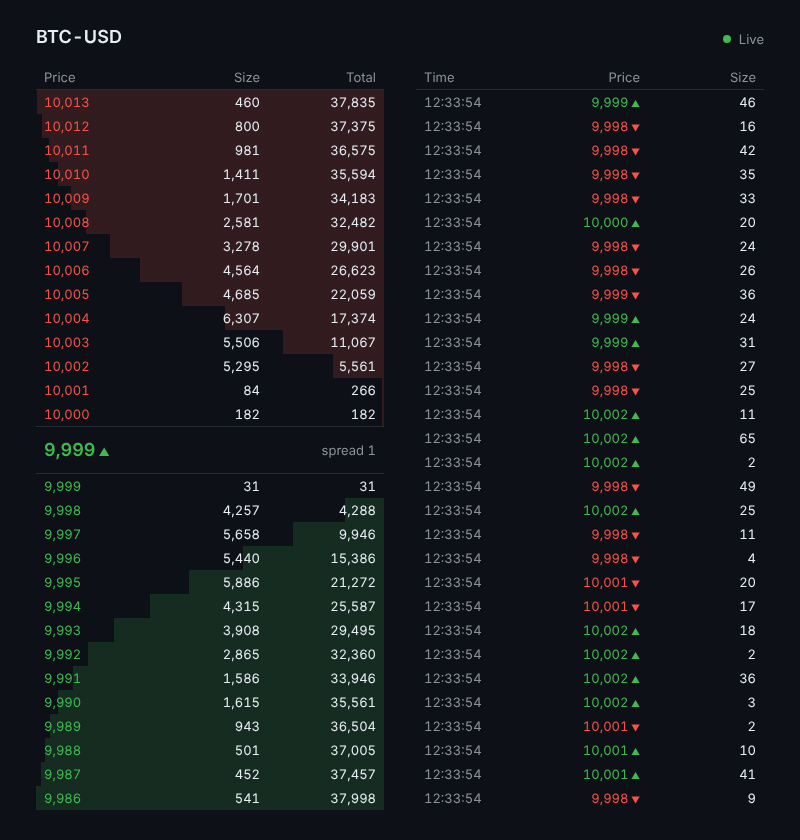
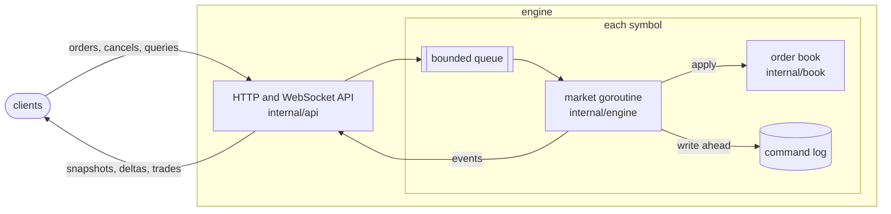

# matching-engine

[](https://github.com/sHyanorn/matching-engine/actions/workflows/ci.yml?query=branch%3Amain)

A limit order book matching engine in Go: price-time priority matching, REST and WebSocket APIs, a write-ahead command log with deterministic replay, and a load-test report.

<p align="center"></p>

## Highlights

Measured on two 4 vCPU cloud VMs; [docs/BENCHMARKS.md](docs/BENCHMARKS.md) says which figure comes from which.

| Metric | Value |
|---|---|
| Core throughput, one symbol | 6.25M to 8.88M commands/s on a noisy VM (± up to 36%); 1.3 to 2.3 times the book before its own order index and node reuse, on that VM |
| Matching core against Liquibook, CppTrader and geseq on one VM ([flash1-dev benchmark](docs/BENCHMARKS.md#against-other-engines), every run hash-checked; no geseq run passes its probe-time rule) | Faster than CppTrader, the fastest of the three there, in 46 of 50 paired runs; median ratio 1.28 to 1.60 per scenario, while one engine's runs vary by up to 2.09 times |
| End-to-end p99, order to trade push | 1.8 ms at 10k requests/s (70% orders, 30% cancels). 50k is near saturation: 41 ms ([why](docs/BENCHMARKS.md#50k-requests-per-second-on-another-machine)) |
| Matching core heap, 1M resting orders (`BenchmarkRestingOrders`) | 124 MiB |
| Test coverage | 93% of statements |

## Architecture



- **One goroutine per symbol** owns its book and log, so books need no locks and each book's results are deterministic: replaying its command log reproduces them ([D003](docs/DECISIONS.md)). Requests reach it through a bounded queue; when it is full, orders and cancels get 503 at once and queries wait for room (D020, D024).
- **The book** keeps price levels in a hand-written red-black tree with a FIFO queue per level (D004), and an index by order ID makes a cancel O(1). Prices and quantities are integers (D002).
- **The command log** gets each batch written to the operating system before the batch is applied and answered, so a crash of the process loses no acknowledged command: a test kills the engine under load and checks every order after the restart. A background goroutine fsyncs the log every 10 ms by default, so a crash of the machine or a power loss can lose acknowledged commands: those of the last interval, plus those taken while an fsync was still running (D017, D031). Replaying it rebuilds the same book (D016). One engine at a time owns the data directory (D028).
- **The stream** sends each subscriber a full snapshot, then the levels each command changed, numbered without gaps; a client that falls behind is disconnected and resubscribes (D018, D026).

## Quick start

With Docker:

```bash
docker compose up -d --wait
```

Open http://localhost:8080 for the live book, and send it order flow:

```bash
docker compose run --rm loadgen -rate 2000 -warmup 0s -duration 60s
```

With Go 1.27.4 or later, from the repository root:

```bash
go run ./cmd/engine
```

```bash
go run ./cmd/loadgen -rate 2000 -warmup 0s -duration 60s
```

Or place an order by hand:

```bash
curl -s localhost:8080/v1/orders -d '{"symbol":"BTC-USD","side":"buy","type":"limit","price":10000,"qty":5}'
```

`make help` lists the test, benchmark, fuzz and load-test targets.

## Layout

| Path | What it holds |
|---|---|
| [`internal/book`](internal/book) | The matching core: price levels, matching, events; no I/O, clock or randomness |
| [`internal/engine`](internal/engine) | Per-symbol goroutines, the command log and replay, order IDs, subscriptions |
| [`internal/api`](internal/api) | REST, WebSocket, metrics and the order book page |
| [`cmd/engine`](cmd/engine) | The service |
| [`cmd/loadgen`](cmd/loadgen) | An open-loop load generator that measures latency |
| [`internal/flow`](internal/flow) | The reproducible order flow both benchmarks use |

## Docs

- [API](docs/API.md)
- [Benchmarks](docs/BENCHMARKS.md)
- [Design decisions](docs/DECISIONS.md)
- [Specification](docs/SPEC.md) and [tasks](docs/TASKS.md)

## License

[MIT](LICENSE)
