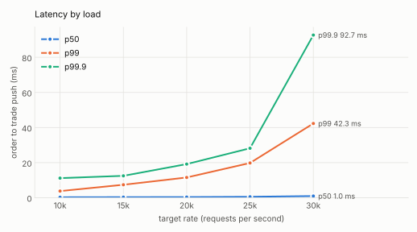
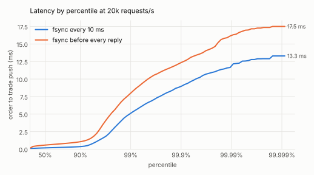
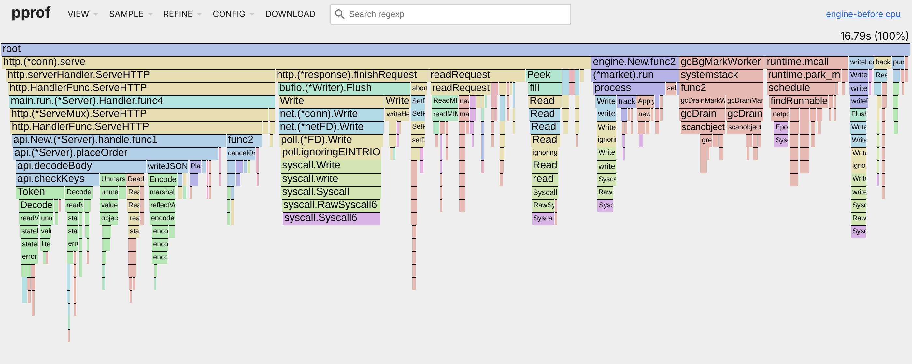
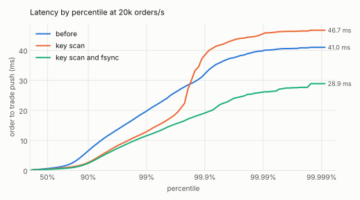
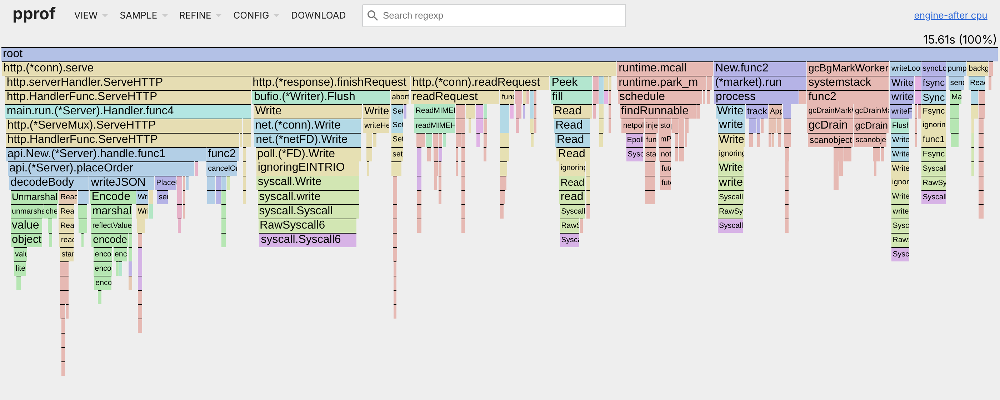

# Benchmarks

On the second machine the matching core handles 6.25M to 8.88M commands per second on one symbol, 1.3 to 2.3 times as many as before its own order index and node reuse (24% to 56% less time per command; D038, D039), and on the flash1-dev benchmark it is faster than CppTrader, the fastest of the three other engines, in 46 of 50 paired runs, with a median ratio of 1.28 to 1.60 per scenario. On the first machine, the end-to-end p99 from a new order to its first trade push is 1.76 ms at 10k requests per second and under 5 ms up to 15k; at 50k it is 41 ms, so the SPEC target of a p99 under 5 ms at 50,000 orders per second (about 71k requests per second in this flow) is out of reach on this machine. 1,000,000 resting orders take 123.7 MiB of heap. All Linux figures come from 4 vCPU cloud VMs with noisy results, and the end-to-end figures predate the faster book (Limits). Raw results are in [`bench-results/`](../bench-results).

## Machines

| Name | Hardware | Used for |
|---|---|---|
| First machine | Intel Xeon 2.10 GHz, 4 vCPUs, Linux 6.18, ext4; Go 1.24.7 | End to end, startup and replay, and every section that names no other machine |
| Second machine | Intel Xeon 2.30 GHz, 4 vCPUs, Linux 6.18; Go 1.27.4 ([`core-reuse/env.txt`](../bench-results/core-reuse/env.txt), [`harness/env.txt`](../bench-results/harness/env.txt)) | Matching core, memory, comparison with other engines |
| Slower VM of the first one's type | | Optimization sweeps |
| Another 4 vCPU VM | | The 50k requests per second rerun |
| GitHub's Windows runners | | Windows disk tests |

## Matching core

`BenchmarkApply` replays 65,536 commands of the SPEC §9 order flow ([`internal/flow`](../internal/flow)): GTC limit orders priced around the mid with a normal spread of 5 or 50 ticks, and about 30% cancels of earlier orders. Each pass starts from an empty book. `BenchmarkApplyDeep` runs the same flow on a book that also holds 10k or 1M resting orders outside the flow's prices. The passes of `BenchmarkApplyDeep` start with the last pass's nodes free, which is why its allocations per command fall further. The table compares the book before (commit ea8d5fe: Go's map as the order index, a new node for every resting order) and now (cb54d8d: its own order index, [D038](DECISIONS.md), and nodes reused, [D039](DECISIONS.md)) on the second machine. The builds ran alternately in 10 rounds, and the figures are medians ([`bench-results/core-reuse`](../bench-results/core-reuse/benchstat.txt)).

| Book | Spread | ns per command, before | ns per command, now | Commands per second, now | Allocations per command, before → now |
|---|---|---|---|---|---|
| empty | 5 ticks | 156 ± 14% | 119 ± 18% | 8.41M | 0.59 → 0.30 |
| empty | 50 ticks | 163 ± 7% | 123 ± 6% | 8.13M | 0.68 → 0.35 |
| 10k resting | 5 ticks | 178 ± 10% | 113 ± 24% | 8.88M | 0.59 → 0.07 |
| 10k resting | 50 ticks | 172 ± 12% | 128 ± 14% | 7.79M | 0.68 → 0.24 |
| 1M resting | 5 ticks | 279 ± 29% | 162 ± 36% | 6.25M | 0.59 → 0.07 |
| 1M resting | 50 ticks | 339 ± 25% | 149 ± 17% | 6.70M | 0.68 → 0.24 |

Every change in time per command is significant (p < 0.001): 24% to 56% less. The SPEC target of 1M operations per second on one symbol holds with 6 to 9 times to spare.

**Memory.** In the matching core alone, 1,000,000 resting orders on 1,000 price levels per side hold 123.7 MiB of heap, 129.7 bytes per order, against 127.7 MiB and 133.9 bytes with Go's map (`BenchmarkRestingOrders`). A book keeps the memory its orders took at its deepest point. The engine process holds more, among it the status of every resting order and of the last 100,000 finished ones per symbol (D022).

## Against other engines

The [flash1-dev matching engine benchmark](https://github.com/flash1-dev/matching-engine-benchmark) drives one engine through a C interface with five scenarios, each of 1M orders and about 2M messages from seed 23, and checks every run's reports against a published hash, so a run whose reports differ does not pass. [`cmd/harness-adapter`](../cmd/harness-adapter) puts the book behind that interface ([D040](DECISIONS.md)); [`scripts/harness.sh`](../scripts/harness.sh) builds it, the benchmark at commit 424e4e5 and three open engines at the commits the benchmark pins: Liquibook, CppTrader and geseq/orderbook ([`versions.txt`](../bench-results/harness/versions.txt)). On the second machine, 10 rounds each ran every engine once on each scenario, one after another, starting one engine later each round.

Liquibook and CppTrader are built with g++ 13.3 at `-O3 -march=native`, geseq with Go 1.24.7 and the harness with clang 18.1. This book, Liquibook and geseq take messages in runs through `engine_on_batch`; CppTrader's adapter takes one message per call. This book's adapter also hands its reports over in runs. The benchmark's geseq adapter does so only with `ME_BULK_EMIT`, which was not set, so geseq pushed each report alone. Without runs, crossing between C and Go dominates: on normal, this book's adapter ran at 2.22M messages/s with one call and one push per message, 2.45M with messages in runs and one push per message, and 6.72M with both in runs ([`adapter/summary.txt`](../bench-results/harness/adapter/summary.txt)).

Median of 10 runs, M messages per second ([`summary.txt`](../bench-results/harness/summary.txt)):

| Scenario | This book | CppTrader | Liquibook | geseq |
|---|---|---|---|---|
| static | 7.27 | 4.83 | 0.02 | 1.32 |
| normal | 6.94 | 4.97 | 2.87 | 1.24 |
| swing-25 | 6.72 | 4.95 | 3.29 | 1.21 |
| swing-40 | 7.12 | 4.41 | 3.17 | 1.14 |
| flash-crash | 7.10 | 5.37 | 3.12 | 1.19 |
| Lowest, the benchmark's result | 6.72 | 4.41 | 0.02 | 1.14 |
| Largest over smallest run of a scenario | 1.20 to 1.46 | 1.79 to 2.09 | 1.24 to 2.07 | 1.33 to 1.60 |
| Runs with the published hash | 50 of 50 | 50 of 50 | 50 of 50 | 50 of 50 |
| Runs the harness calls VALID | 50 of 50 | 50 of 50 | 50 of 50 | 0 of 50 |

- **Run by run.** In the same round and scenario, this book was faster than CppTrader in 46 of 50 runs; the median ratio per scenario was 1.28 to 1.60, and single ratios ran from 0.92 to 2.08.
- **geseq.** Every run had the published hash, and its state audits match Liquibook's. The harness calls a run INVALID when its probes take more than 25% of the timed window ([`src/harness.cpp`](https://github.com/flash1-dev/matching-engine-benchmark/blob/424e4e5649652febb5b0c4c80859d74c4654131e/src/harness.cpp#L777)); in geseq's 50 runs they took 46.6% to 56.5%, so none is VALID.
- **Liquibook** took 105 to 129 s for each static run, 0.02M messages per second; its medians on the other scenarios were 2.87M to 3.29M.
- **Correctness.** On the benchmark's 34 conformance cases the three reference engines produce the same report stream and this book's equals it ([`conformance.txt`](../bench-results/harness/conformance.txt)); CI runs the 34 cases against `internal/harness`. This book and CppTrader are VALID in the state audit on all five scenarios.

## End to end

[`cmd/loadgen`](../cmd/loadgen) offers the same flow at a fixed rate, 70% of requests new orders and 30% cancels ([D030](DECISIONS.md)). Request i is due at t0 + i/rate whatever the replies and goes out over one of 64 keep-alive connections, and latency counts from the due time, so a stall is charged to every request it delayed. The latency reported runs from the due time of a new order to the first trade push for it on the WebSocket. Each run starts a fresh engine on an empty data directory (fsync every 10 ms, one symbol), discards a 10 s warmup and measures 30 s; each rate runs three times, and the run with the median p99 stands for it. A run is valid only if 99% of the target rate went out, no request failed, and every trade was pushed once and in order, which the pushes, the trades in the replies and the engine's trade counter confirm by number and by a hash of each trade ([D036](DECISIONS.md)). A 1 ms sleep loop in loadgen records its own pauses (hiccups, after jHiccup). More connections than the load needs only add work on both sides: on the slower VM at 15k/s, 512 connections gave a p99 of 11.2 ms against 7.26 ms with 64.

Latency from order to trade push, in ms ([`bench-results/e2e-review/default`](../bench-results/e2e-review/default)):

| Requests/s | Valid runs | p50 | p90 | p99 | p99.9 | max | p99 of each run | Engine CPU per request | Worst hiccup |
|---|---|---|---|---|---|---|---|---|---|
| 10k/s | 3 of 3 | 0.20 | 0.82 | 1.76 | 5.96 | 9.33 | 1.73, 1.76, 1.89 | 95 µs | 6 ms |
| 15k/s | 3 of 3 | 0.18 | 0.33 | 3.37 | 7.35 | 12.5 | 3.16, 3.37, 3.44 | 82 µs | 8 ms |
| 20k/s | 3 of 3 | 0.19 | 0.37 | 5.14 | 8.96 | 13.5 | 5.03, 5.14, 5.57 | 70 µs | 7 ms |
| 25k/s | 3 of 3 | 0.20 | 0.51 | 7.41 | 11.9 | 19.0 | 7.10, 7.41, 10.3 | 62 µs | 53 ms |
| 30k/s | 3 of 3 | 0.22 | 1.64 | 10.7 | 22.6 | 31.9 | 10.6, 10.7, 10.9 | 54 µs | 12 ms |
| 40k/s | 3 of 3 | 0.32 | 7.24 | 22.7 | 28.7 | 36.5 | 21.5, 22.7, 24.3 | 45 µs | 15 ms |
| 50k/s | 3 of 3 | 0.98 | 21.2 | 41.1 | 48.5 | 53.7 | 40.0, 41.1, 43.4 | 39 µs | 22 ms |
| 60k/s | 0 of 1 | | | | | | sent 59.1k/s | | |



- **Capacity.** At 60k requests/s loadgen sent 1.5% too few requests and fell so far behind on the trade stream that the engine disconnected it as a slow consumer. The engine alone takes about 2 cores at 50k/s; loadgen's CPU was not recorded at these rates.
- **Engine CPU per request** falls as the rate rises, which fits fixed costs, from idle wakeups to GC, being shared by more requests.
- **The tail** above p99 depends on single pauses. The hiccup meter runs no engine code, yet it saw pauses of up to 53 ms, in the 25k/s run with a 10.3 ms p99. The spread between runs at one rate shows how far to trust a single run.

### 50k requests per second

The p99 at 50k/s depends on the machine: 40.0, 41.1 and 43.4 ms in the table (median 41.1 ms) and 123.5, 141.1 and 148.3 ms (median 141.1 ms) in three runs of the same sweep on another 4 vCPU VM, which reproduced the table at 10k/s (1.75 ms against 1.76 ms). The setup is close to capacity: with a target of 60k/s the machine here sent 59.1k/s. At 50k/s the median service time was 0.43 to 0.49 ms, and the lag between a request's due time and its send (a p99 of 38 to 42 ms) made up nearly all of the p99: the 64 connections carry one request each, so a stall of more than 1.28 ms leaves requests due while every connection is busy, and with so little capacity to spare the backlog drains slowly.

### An fsync before every reply

With `-sync-interval=-1ns` the engine fsyncs each batch before it replies, so a machine crash loses no acknowledged command either ([`bench-results/e2e-review/fsync-each-batch`](../bench-results/e2e-review/fsync-each-batch)):

| Requests/s | Valid runs | p50 | p90 | p99 | p99.9 | max | p99 of each run | Engine CPU per request |
|---|---|---|---|---|---|---|---|---|
| 10k/s | 3 of 3 | 0.48 | 0.72 | 2.81 | 15.6 | 37.3 | 2.57, 2.81, 3.33 | 115 µs |
| 15k/s | 3 of 3 | 0.53 | 0.85 | 4.85 | 9.54 | 15.2 | 3.95, 4.85, 5.70 | 86 µs |
| 20k/s | 3 of 3 | 0.58 | 1.07 | 7.99 | 12.4 | 17.6 | 7.39, 7.99, 8.66 | 70 µs |
| 25k/s | 3 of 3 | 0.72 | 3.50 | 14.5 | 20.6 | 24.8 | 12.7, 14.5, 14.6 | 62 µs |
| 30k/s | 3 of 3 | 0.83 | 6.17 | 21.2 | 31.7 | 41.8 | 20.9, 21.2, 28.7 | 54 µs |
| 40k/s | 3 of 3 | 63.7 | 212 | 254 | 267 | 270 | 67.4, 254, 296 | 44 µs |
| 50k/s | 0 of 1 | | | | | | sent 38.2k/s | |



- An fsync on this VM's disk takes 0.16 ms on average at 10k/s and up to 0.26 ms at 40k/s as the batches grow. Every command of a batch waits for it, so the p50 rises by 0.3 to 0.6 ms and the p99 by 1 to 10 ms up to 30k/s.
- At 30k/s the symbol's goroutine spends about three quarters of its time in fsync, with about 8 requests per batch, and at 40k/s it falls behind: the runs stay valid, as no request failed, but the p99 reaches 254 ms (67 to 296 ms across runs).
- The interval fsync bounds what a machine crash loses to one interval of commands plus those taken during an fsync still running ([D031](DECISIONS.md)), and costs little. An fsync per batch loses nothing acknowledged but costs latency at every rate and capacity from 40k/s, and more on a disk with slower fsyncs, such as the Windows runners' system disk below.

## Where the time goes

A CPU profile of the engine at 25k/s before the optimizations (host not recorded; [`bench-results/m5-opt/cpu-before.pprof`](../bench-results/m5-opt/cpu-before.pprof)):



Reading and writing HTTP takes the largest share, about 19% in system calls alone. Decoding request bodies took 14%, of which 9.2 points were the check of their keys. GC took about 10%, and the matching goroutine, book included, about 10%. Two changes followed, each measured with the full sweep on the slower VM ([`bench-results/m5-e2e`](../bench-results/m5-e2e) holds the three sweeps). The table gives the p99 in ms before the changes, after the key scan, and after the fsync change too, with the engine's CPU per request:

| Requests/s | p99 before | Keys scanned | And fsync aside | Engine CPU per request |
|---|---|---|---|---|
| 10k/s | 5.65 | 5.32 | 3.82 | 138 → 131 → 131 µs |
| 15k/s | 9.64 | 8.25 | 7.41 | 107 → 101 → 105 µs |
| 20k/s | 19.8 | 12.9 | 11.6 | 88 → 82 → 84 µs |
| 25k/s | 26.7 | 36.4 | 19.8 | 75 → 69 → 71 µs |
| 30k/s | sent 29.4k/s | 37.7 | 42.3 | 61 → 62 µs |
| 40k/s | | sent 32.8k/s | sent 39.2k/s | |



**Checking request keys with one scan.** A request body must be one JSON object whose field names match exactly, with no unknown or repeated fields ([API](API.md#post-v1orders)). The check decoded every value with a `json.Decoder`, which builds a syntax error after each key and scalar value and discards it. Now `json.Valid` checks the syntax and one scan finds the keys; a fuzz test holds the new check to the old one's answers. The check takes 0.51 µs instead of 5.79 µs ([`checkkeys.txt`](../bench-results/m5-opt/checkkeys.txt)), fell from 9.2% to 1.1% of the engine's CPU profile and cut its CPU per request by 5% to 8%; the 30k/s runs became valid.

**Running the fsync beside the matching goroutine** ([D031](DECISIONS.md)). Every 10 ms the symbol's goroutine stopped for its fsync, 0.8 ms on average and tens of milliseconds at times, and every command waited; a helper goroutine now runs it. At 10k/s, p90 fell from 0.91 to 0.57 ms and the median run's p99 from 5.32 to 3.82 ms, though the runs' ranges overlap (3.95 to 6.03 ms before, 3.81 to 7.68 ms after); at 30k/s the median p99 rose from 37.7 to 42.3 ms; at 25k/s the runs' p99 went from 20.0, 36.4 and 215 ms to 19.6, 19.8 and 28.7 ms; 40k/s sent 39.2k/s. The engine's CPU per request rose by up to 4%, with no change at 10k/s.

The profile after both changes ([`cpu-after.pprof`](../bench-results/m5-opt/cpu-after.pprof)), where the fsync runs on its own stack (`syncLoop`):



## Startup and replay

The engine starts by replaying each symbol's whole command log; there are no snapshots and no log compaction (SPEC §3 lists snapshot recovery as optional). `BenchmarkReplay` starts an engine on a log of 1M commands of the flow and closes it ([`bench-results/replay`](../bench-results/replay/replay.txt), median of 10 runs). It replays 1.87M commands/s, 534 ns each, about 3.7 times the cost of `Book.Apply` alone on the same flow, both measured before D038 and D039: each record is also read, checksummed and decoded, and the order history is rebuilt. A log takes 45 bytes per command without a `client_id`. Extrapolated linearly, at 10k requests/s an hour of load is about 36M commands, a 1.6 GB log and 19 s of replay; a day is 864M commands, 39 GB and about 8 minutes.

## On Windows

On GitHub's Windows runners the cost of an fsync depends on the disk ([`disks.txt`](../bench-results/m6-windows/disks.txt)). On the runner's system disk the median fsync after a write ranged from 3 to 31 ms across runs and write sizes, a write-through write from 4 to 30 ms, and writes to the file being flushed wait meanwhile. On its local disk both take under 1 ms, as on Linux. Writes to another file do not wait for a flush on either disk. No engine run was made on Windows.

## Limits

- **Machines.** Figures differ between machines. Before D038 and D039 the book took 144 to 198 ns per command on the first machine, with a ± of at most 5% ([`core-current`](../bench-results/core-current/benchstat.txt), commit b9d0d3f), and 224 to 333 ns on another VM of that type ([`m5-core`](../bench-results/m5-core/baseline.txt)); the ± in the core table reaches 36%. The benchmark's own table was measured on Graviton4 and does not compare with the figures here.
- **Engine comparison.** This book's adapter and CppTrader's differ in delivery: this book receives messages and hands reports over in runs, CppTrader takes one message per call. With one call and one push per message this book ran at 2.22M messages/s, below CppTrader's medians of 4.41M to 5.37M. It is not recorded which commit the perf adapter was built from ([`harness/env.txt`](../bench-results/harness/env.txt)). One engine's runs of one scenario differ by up to 1.46 times for this book and up to 2.09 times for the others, so the table ranks the engines on this VM and says nothing about absolute throughput. The hash and the 34 conformance cases leave out the quantity of a cancel ack and the order of a message's reports of different types; [`harness_test.go`](../internal/harness/harness_test.go) pins both for this book's adapter.
- **Core memory and pauses.** The order index saves memory at 1M resting orders only: at 850,000 the Go map holds 118.6 bytes per order against the index's 135.7, and at 1,200,000 127.7 against 180.0 ([D038](DECISIONS.md)). The largest single `Apply` while 1M orders come to rest is 8.59 and 4.53 ms with the index against about 1.0 ms with the map, so D038's 2 ms target for that pause is not met.
- **End to end.** Loadgen and the engine share the 4 vCPUs. The same commit moved from 1.68 to 2.96 ms p99 at 10k/s between container restarts ([`ws-backlog`](../bench-results/ws-backlog/README.md)), and the slower VM measured 3.82 ms at 10k/s and 7.41 ms at 15k/s. The figures predate D038 and D039 and have not been measured again; `Book.Apply` is 1.4% to 2% of the engine's CPU in the profiles. The 141.1 ms at 50k/s on another VM comes from reports that are not in this repository. The optimization sweeps ran on the slower VM, which used 131 µs of CPU per request at 10k/s against 95 µs on the first machine and recorded a stall of up to about 128 ms in one 10k/s run ([`after-fsync`](../bench-results/m5-e2e/after-fsync), commit ec2f59e, before D035 and D036); their comparisons hold within it and their absolute figures do not carry over.
- **Between two machines.** The only latency between two machines that this repository claims is the round trip of OE1 Pings between two rented Pods, the floor of [`pair-floor`](../bench-results/pair-floor/README.md) (p50 56.3 to 64.2 µs over five runs). It claims no latency of the engine between two machines: two pilot pairs did not pass their gate, and their tables are published as they came out, not as claims ([`pair-pilot-1`](../bench-results/pair-pilot-1/README.md), [`pair-pilot-2`](../bench-results/pair-pilot-2/README.md), [D052](DECISIONS.md)).
- **Go version.** The first machine's figures were measured with Go 1.24.7 and the project now builds with Go 1.27.4. Go 1.27.3 showed no slowdown in the core benchmarks, which ran on a third, slower and noisier VM with the book before D038 ([`bench-results/go1.27`](../bench-results/go1.27/benchstat.txt), [D037](DECISIONS.md)); 1.27.4 is a security patch release and was not compared with 1.27.3.
- **Durability.** No test covers a machine crash on Linux ([D017](DECISIONS.md)), and on Windows a log or ID reservation just created or renamed may be lost ([D027](DECISIONS.md)).
- **Replay.** The benchmark reads a log the page cache holds; a cold start also waits for the disk. The log grows without bound, and so does the startup time; snapshots with log truncation would bound both and are not built.
- **Windows.** The figures are disk tests. A laptop's local SSD should behave like the runner's local disk, but that was not measured.

## Measuring again

```bash
go test -run='^$' -bench='^(BenchmarkApply|BenchmarkApplyDeep|BenchmarkRestingOrders)$' -benchmem -count=10 ./internal/book
```

The comparison of builds under Matching core builds a test binary of each commit with `go test -c -o book.NAME.test ./internal/book` (the build with only node reuse is ea8d5fe with [`reuse-on-map.diff`](../bench-results/core-reuse/reuse-on-map.diff) applied), alternates them with [`bench-results/core-reuse/run.sh`](../bench-results/core-reuse/run.sh) `OUT 1 10 NAME...` and compares them with benchstat (`golang.org/x/perf/cmd/benchstat`).

The comparison with other engines needs git, clang, cmake, g++, Go, python3, and the Boost headers and {fmt} library (libboost-dev and libfmt-dev on Ubuntu); DIR is a working directory outside the repository:

```bash
scripts/harness.sh setup DIR
scripts/harness.sh cases DIR bench-results/harness
scripts/harness.sh perf DIR bench-results/harness 1 10
scripts/harness.sh summary bench-results/harness > bench-results/harness/summary.txt
```

The adapter variants apply [`no-batch.diff`](../bench-results/harness/adapter/no-batch.diff) or [`push-each.diff`](../bench-results/harness/adapter/push-each.diff) to `cmd/harness-adapter/main.go`, build the library as `setup` does, and run the harness on normal ten times each.

```bash
go test -run='^$' -bench='^BenchmarkReplay$' -benchmem -count=10 ./internal/engine
```

```bash
make e2e OUT=bench-results/e2e
```

```bash
ENGINE_FLAGS=-sync-interval=-1ns make e2e OUT=bench-results/e2e-fsync
```

```bash
python3 scripts/plot.py sweep docs/img/latency-by-load.svg bench-results/e2e
python3 scripts/plot.py percentiles docs/img/latency-durability.svg 20000 "fsync every 10 ms=bench-results/e2e" "fsync before every reply=bench-results/e2e-fsync"
```

The engine serves profiles with `-pprof`, for example `go run ./cmd/engine -pprof 127.0.0.1:6060`, then `go tool pprof -http=: 'http://127.0.0.1:6060/debug/pprof/profile?seconds=10'` while loadgen runs.
