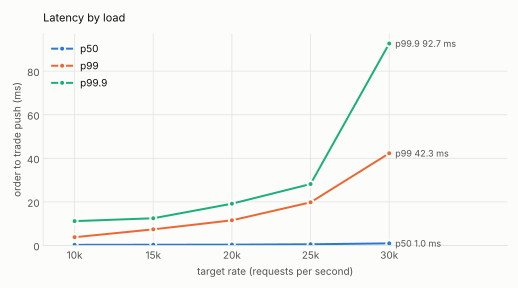
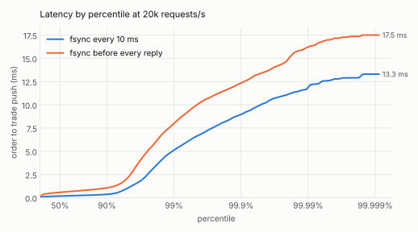
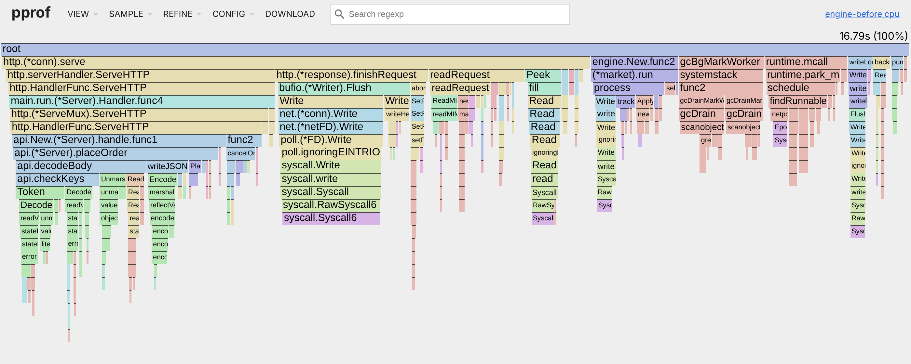
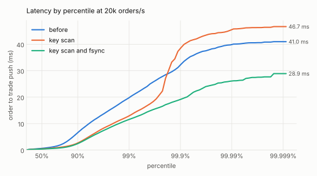
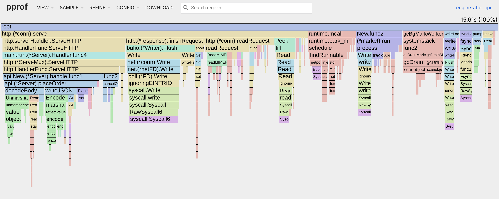

# Benchmarks

Every number here comes from one machine and can be measured again with the commands at the end, except where a section says otherwise: the optimization sweeps ran on another, slower VM of the same type, and the Windows figures come from GitHub's runners. The raw results are in [`bench-results/`](../bench-results).

**Machine**: a cloud VM with an Intel Xeon at 2.10 GHz, 4 vCPUs and 16 GB, Linux 6.18 on ext4. The figures were measured with Go 1.24.7. The project now builds with Go 1.27.3, which showed no measurable change in the core benchmarks ([`bench-results/go1.27`](../bench-results/go1.27/benchstat.txt), [D037](DECISIONS.md)). In the end-to-end runs the load generator and the engine share the 4 vCPUs.

## Matching core

`BenchmarkApply` replays 65,536 commands of the SPEC §9 order flow ([`internal/flow`](../internal/flow)): GTC limit orders priced around the mid with a normal spread of 5 or 50 ticks, and about 30% cancels of earlier orders, some of them already filled. Each pass starts from an empty book. `BenchmarkApplyDeep` runs the same flow on a book that also holds 10k or 1M resting orders outside the flow's prices, as a book does after hours of trading. The figures are medians of 10 runs ([`bench-results/core-current`](../bench-results/core-current/benchstat.txt)).

| Book | Spread | ns per command | Commands per second | Allocations per command |
|---|---|---|---|---|
| empty | 5 ticks | 144 ± 3% | 6.95M | 0.59 |
| empty | 50 ticks | 151 ± 4% | 6.61M | 0.68 |
| 10k resting | 5 ticks | 155 ± 5% | 6.46M | 0.59 |
| 10k resting | 50 ticks | 144 ± 3% | 6.93M | 0.68 |
| 1M resting | 5 ticks | 186 ± 2% | 5.39M | 0.59 |
| 1M resting | 50 ticks | 198 ± 2% | 5.05M | 0.68 |

The SPEC target of 1M operations per second on one symbol holds with 5 to 7 times to spare. An earlier run on another VM of this type ([`m5-core`](../bench-results/m5-core/baseline.txt)) took 224 to 334 ns, 1.5 to 1.7 times as long. Go's `allocs/op` prints 0 for these runs because it rounds down; `allocs/cmd` keeps the fraction. An order that rests allocates its node, a new price level its tree node, and the ID map grows now and then.

**Memory**: in the matching core alone, 1,000,000 resting orders on 1,000 price levels per side hold 127.7 MiB of heap, 134 bytes per order (`BenchmarkRestingOrders`), as in the earlier run. The engine process holds more, among it the status of every resting order and of the last 100,000 finished ones per symbol (D022).

## End to end

Method ([D030](DECISIONS.md)):

- [`cmd/loadgen`](../cmd/loadgen) offers the same flow at a fixed rate of requests, 70% of them new orders and 30% cancels. Request i is due at t0 + i/rate whatever the replies, and goes out over one of 64 keep-alive connections. Latency counts from the due time, so a stall is charged to every request it delayed.
- The latency reported here runs from the due time of a new order to the first trade push for it on the WebSocket. The JSON reports also hold the reply latency of every request, the service time (from the actual send) and the send lag.
- Each run starts a fresh engine on an empty data directory (fsync every 10 ms, one symbol), discards a 10 s warmup and measures 30 s. Each rate runs three times, and the run with the median p99 stands for it. A run is valid only if 99% of the target rate went out, no request failed, and every trade was pushed once and in order ([D036](DECISIONS.md)): the push numbers run without gaps, and the pushes, the trades in the replies and the engine's trade counter agree in number and, by a hash of each trade, in content.
- A 1 ms sleep loop in loadgen records pauses of the generator and the machine (hiccups, after jHiccup).
- More connections than the load needs only add work on both sides: at 15k/s, 512 connections gave a p99 of 11.2 ms against 7.26 ms with 64 ([`conns-64`](../bench-results/m5-e2e/conns-64), [`conns-512`](../bench-results/m5-e2e/conns-512)).

Latency from order to trade push, in ms ([`bench-results/e2e-review/default`](../bench-results/e2e-review/default)):

| Requests/s | Valid runs | p50 | p90 | p99 | p99.9 | max | p99 of each run | Engine CPU per request | Worst hiccup |
|---|---|---|---|---|---|---|---|---|---|
| 10k/s | 3 of 3 | 0.20 | 0.82 | 1.76 | 5.96 | 9.33 | 1.73, 1.76, 1.89 | 95 µs | 6 ms |
| 15k/s | 3 of 3 | 0.18 | 0.33 | 3.37 | 7.35 | 12.5 | 3.16, 3.37, 3.44 | 82 µs | 8 ms |
| 20k/s | 3 of 3 | 0.19 | 0.37 | 5.14 | 8.96 | 13.5 | 5.03, 5.14, 5.57 | 70 µs | 7 ms |
| 25k/s | 3 of 3 | 0.20 | 0.51 | 7.41 | 11.9 | 19.0 | 7.10, 7.41, 10.3 | 62 µs | 53 ms |
| 30k/s | 3 of 3 | 0.22 | 1.64 | 10.7 | 22.6 | 31.9 | 10.6, 10.7, 10.9 | 54 µs | 12 ms |
| 40k/s | 3 of 3 | 0.32 | 7.24 | 22.7 | 28.7 | 36.5 | 21.5, 22.7, 24.3 | 45 µs | 15 ms |
| 50k/s | 3 of 3 | 0.98 | 21.2 | 41.1 | 48.5 | 53.7 | 40.0, 41.1, 43.4 | 39 µs | 22 ms |
| 60k/s | 0 of 1 | | | | | | sent 59.1k/s | | |



- **Capacity.** At 60k requests/s the two processes use up the 4 vCPUs: loadgen sent 1.5% too few requests and fell so far behind on the trade stream that the engine disconnected it as a slow consumer. The engine alone takes about 2 cores at 50k/s. The SPEC target, a p99 under 5 ms at 50,000 orders/s (about 71k requests/s in this flow), is out of reach on this machine; the p99 is under 5 ms up to 15k requests/s.
- **Engine CPU per request** is the process's CPU time over the run divided by the requests it answered. It falls as the rate rises because the fixed costs, from idle wakeups to GC, are shared by more requests.
- **The tail** above p99 depends on single pauses. The hiccup meter runs no engine code, yet it saw pauses of up to 53 ms, in the 25k/s run with a 10.3 ms p99. This cloud VM stalls now and then for up to about 128 ms, as one earlier 10k/s run recorded ([`after-fsync`](../bench-results/m5-e2e/after-fsync)). The spread between runs at one rate shows how far to trust a single run.
- **An earlier sweep** at an earlier commit ([`after-fsync`](../bench-results/m5-e2e/after-fsync), ec2f59e, before D035 and D036) ran on another VM of this type, a slower one: its engine took 131 µs of CPU per request at 10k/s against 95 µs here, its p99 there was 3.82 ms, and 40k/s was invalid. The sweeps under Optimizations ran on that VM too; each compares steps measured there, so their comparisons hold.

### An fsync before every reply

With `-sync-interval=-1ns` the engine fsyncs each batch before it replies, so a machine crash loses no acknowledged command either ([`bench-results/e2e-review/fsync-each-batch`](../bench-results/e2e-review/fsync-each-batch)):

| Requests/s | Valid runs | p50 | p90 | p99 | p99.9 | max | p99 of each run | Engine CPU per request |
|---|---|---|---|---|---|---|---|---|
| 10k/s | 3 of 3 | 0.48 | 0.72 | 2.81 | 15.6 | 37.3 | 2.57, 2.81, 3.33 | 115 µs |
| 15k/s | 3 of 3 | 0.53 | 0.85 | 4.85 | 9.54 | 15.2 | 3.95, 4.85, 5.70 | 86 µs |
| 20k/s | 3 of 3 | 0.58 | 1.07 | 7.99 | 12.4 | 17.6 | 7.39, 7.99, 8.66 | 70 µs |
| 25k/s | 3 of 3 | 0.72 | 3.50 | 14.5 | 20.6 | 24.8 | 12.7, 14.5, 14.6 | 62 µs |
| 30k/s | 3 of 3 | 0.83 | 6.17 | 21.2 | 31.7 | 41.8 | 20.9, 21.2, 28.7 | 54 µs |
| 40k/s | 3 of 3 | 63.7 | 212 | 254 | 267 | 270 | 67.4, 254, 296 | 44 µs |
| 50k/s | 0 of 1 | | | | | | sent 38.2k/s | |



- An fsync on this VM's disk takes 0.16 ms on average at 10k/s and up to 0.26 ms at 40k/s, as the batches it syncs grow. Every command of a batch waits for it, so the p50 rises by 0.3 to 0.6 ms and the p99 by 1 to 10 ms up to 30k/s.
- The fsyncs group commands: at 10k/s about 5,400 batches a second were synced, about 2 requests each, and at 30k/s about 3,800, about 8 requests each. At 30k/s the symbol's goroutine spends about three quarters of its time in fsync, and at 40k/s it falls behind: the runs stay valid, as no request failed, but requests queue for a quarter of a second.
- The interval fsync bounds what a machine crash loses to one interval of commands, plus those taken during an fsync still running (D031), and costs little; an fsync per batch loses nothing acknowledged and costs latency at every rate, and capacity from 40k/s. On a disk with slower fsyncs, such as the Windows runners' system disk below, the cost grows with the fsync time.

## Where the time goes

A CPU profile of the engine at 25k/s before the optimizations ([`bench-results/m5-opt/cpu-before.pprof`](../bench-results/m5-opt/cpu-before.pprof)):



Reading and writing HTTP takes the largest share, about 19% in system calls alone. Decoding request bodies took 14%, 9% of it in the check of their keys. GC took about 10%, and the matching goroutine, book included, about 10%.

## Optimizations

Each change was measured with the full sweep above, on the slower VM; [`bench-results/m5-e2e`](../bench-results/m5-e2e) holds the three sweeps.

| Requests/s | p99 before | Keys scanned | And fsync aside | Engine CPU per request |
|---|---|---|---|---|
| 10k/s | 5.65 | 5.32 | 3.82 | 138 → 131 → 131 µs |
| 15k/s | 9.64 | 8.25 | 7.41 | 107 → 101 → 105 µs |
| 20k/s | 19.8 | 12.9 | 11.6 | 88 → 82 → 84 µs |
| 25k/s | 26.7 | 36.4 | 19.8 | 75 → 69 → 71 µs |
| 30k/s | sent 29.4k/s | 37.7 | 42.3 | 61 → 62 µs |
| 40k/s | | sent 32.8k/s | sent 39.2k/s | |



**Checking request keys with one scan.** A request body must be one JSON object whose field names match exactly, with no unknown or repeated fields ([API](API.md#post-v1orders)). The check decoded every value with a `json.Decoder`, which builds a syntax error after each key and scalar value and throws it away. Now `json.Valid` checks the syntax and one scan finds the keys; a fuzz test holds the new check to the old one's answers.

- The check takes 0.51 µs instead of 5.79 µs, with 0 allocations instead of 79 ([`checkkeys.txt`](../bench-results/m5-opt/checkkeys.txt)).
- It fell from 9.2% to 1.1% of the engine's CPU profile, and the engine's CPU per request fell 5% to 8%.
- 30k/s became sustainable, and 40k/s sent 32.8k/s.

**Running the fsync beside the matching goroutine** ([D031](DECISIONS.md)). Every 10 ms the symbol's goroutine stopped for its fsync, 0.8 ms on average and tens of milliseconds at times, and every command waited. A helper goroutine now runs it, as Redis, Kafka and PostgreSQL do with their logs.

- At 10k/s, p90 fell from 0.91 to 0.57 ms and p99 from 5.32 to 3.82 ms.
- At 25k/s the runs' p99 went from 20.0, 36.4 and 215 ms to 19.6, 19.8 and 28.7 ms.
- 40k/s sent 39.2k/s. The engine's CPU per request rose by up to 3%, with no change at 10k/s.

The profile after both changes ([`cpu-after.pprof`](../bench-results/m5-opt/cpu-after.pprof)); the fsync runs on its own stack (`syncLoop`):



The book allocates 0.6 times per command, but `Book.Apply` is 1.4% to 2% of the engine's CPU, so pooling its nodes would not show end to end; it is not done.

## Startup and replay

The engine starts by replaying each symbol's whole command log; there are no snapshots and no log compaction (SPEC §3 lists snapshot recovery as optional). `BenchmarkReplay` starts an engine on a log of 1M commands of the flow and closes it ([`bench-results/replay`](../bench-results/replay/replay.txt), median of 10 runs):

- **Speed.** 1.87M commands/s, 534 ns each, about 3.5 times the cost of `Book.Apply` alone: each record is also read, checksummed and decoded, and the order history is rebuilt. A log takes 45 bytes per command without a `client_id`.
- **Startup time.** At 10k requests/s, an hour of load is about 36M commands, a 1.6 GB log and 19 s of replay; a day is 864M commands, 39 GB and about 8 minutes. The benchmark reads a log the page cache holds; a cold start also waits for the disk to read the log.
- **Known limit.** The log grows without bound, and so does the startup time with it. Snapshots with log truncation would bound both; they are not built.

## On Windows

All the figures above are from Linux. On GitHub's Windows runners the cost of an fsync depends on the disk ([`disks.txt`](../bench-results/m6-windows/disks.txt)). On the runner's system disk the median fsync after a write ranged from 3 to 31 ms across runs and write sizes, a write-through write from 4 to 30 ms, and writes to the file being flushed wait meanwhile; there, requests wait tens of milliseconds. On its local disk both take under 1 ms, as on Linux; a laptop's local SSD should behave alike, though that was not measured. Writes to another file do not wait for a flush on either disk.

## Measuring again

```bash
go test -run='^$' -bench='^(BenchmarkApply|BenchmarkApplyDeep|BenchmarkRestingOrders)$' -benchmem -count=10 ./internal/book
```

```bash
go test -run='^$' -bench='^BenchmarkReplay$' -benchmem -count=10 ./internal/engine
```

```bash
make e2e OUT=bench-results/e2e
```

```bash
ENGINE_FLAGS=-sync-interval=-1ns make e2e OUT=bench-results/e2e-fsync
```

```bash
python3 scripts/plot.py sweep docs/img/latency-by-load.svg bench-results/e2e
python3 scripts/plot.py percentiles docs/img/latency-durability.svg 20000 "fsync every 10 ms=bench-results/e2e" "fsync before every reply=bench-results/e2e-fsync"
```

The engine serves profiles with `-pprof`, for example `go run ./cmd/engine -pprof 127.0.0.1:6060`, then `go tool pprof -http=: 'http://127.0.0.1:6060/debug/pprof/profile?seconds=10'` while loadgen runs.
